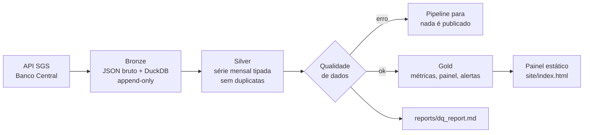

# Monitor de crédito e inadimplência no Brasil: pipeline de dados com dados abertos do Banco Central

 

> **EN summary.** A data-engineering project that ingests Brazil's credit delinquency, lending rates and Selic series from the Central Bank's open API (SGS), organizes them in **bronze / silver / gold layers with SQL (DuckDB)**, blocks bad data with a **data-quality gate**, and publishes a static dashboard with statistical alerts. Tested offline (31 tests) with synthetic data in the API's format.

## O que este projeto demonstra

- **Ingestão robusta** da API pública do Banco Central, com timeout, repetição com espera progressiva e validação do formato da resposta.
- **Arquitetura em camadas** (bronze, silver, gold) com transformações em **SQL**: tipagem, deduplicação por revisão, janelas, junções por mês calendário e z-score.
- **Qualidade de dados como etapa do pipeline**: 9 checagens; se houver erro, o processo para antes de gerar a camada gold e o painel.
- **Resultado analítico**: painel estático com inadimplência (total, PF, PJ, cheque especial e consignado), juros, Selic, diferença entre juros e Selic e alertas estatísticos.
- **Engenharia**: 31 testes (incluindo defeitos injetados nos dados), CI e execução agendada.

## Arquitetura



Séries, códigos do SGS, tabelas e checagens: [`docs/DATA_CATALOG.md`](docs/DATA_CATALOG.md).

## Como rodar

```bash
git clone https://github.com/AndreMarques2002/bcb-credit-monitor.git
cd bcb-credit-monitor
python -m venv .venv && source .venv/bin/activate        # Windows: .venv\Scripts\activate
pip install -r requirements.txt
pip install -e .

python -m creditmonitor.pipeline --source live           # dados reais do Banco Central (precisa de internet)
pytest -q                                                # testes (offline)
```

Depois da execução, abra `site/index.html`. O relatório de qualidade fica em `reports/dq_report.md` e os dados do painel em `site/credit_monitor.csv`.
Sem internet, `--source synthetic` roda tudo com **dados sintéticos** no formato da API, só para demonstração (os valores não são do Banco Central).

## Painel e resultados

> **PREENCHER:** rode com `--source live`, adicione aqui uma captura de `site/index.html` e os principais números
> do relatório de qualidade (`reports/dq_report.md`). Se publicar o painel no GitHub Pages, coloque o link aqui.

## Decisões de projeto

| Decisão | Motivo |
|---|---|
| Camada bronze somente de acréscimo, com `ingested_at` | Preserva o que o BC publicou em cada data e permite auditar e reprocessar |
| Silver deduplica pela ingestão mais recente | O BC revisa valores; o mais recente deve valer sem apagar o histórico bruto |
| Qualidade de dados antes da camada gold | Um painel com dado ruim é pior do que nenhum painel |
| Variações (mês e 12 meses) por junção em mês calendário, não `LAG` | `LAG` compararia com o registro errado se faltasse um mês |
| Checagem "total entre PF e PJ" | O total é uma média ponderada das duas carteiras; se sair do intervalo, algo está errado (código trocado, dado corrompido) |
| DuckDB local em vez de um banco em nuvem | Roda em qualquer máquina e no CI sem credenciais; o SQL é simples e portável |
| Alerta por z-score sobre a variação mensal | Sinaliza movimentos incomuns sem pretender prever nada |
| Só séries mensais | Evita limites da API para séries diárias e mantém a periodicidade comparável |

## Limitações

- **Não consegui acessar a API do Banco Central a partir do meu ambiente**, então a execução com dados reais não foi testada por mim. O que foi testado: o cliente com respostas simuladas (incluindo falhas e repetição), o SQL, as checagens e o pipeline completo com dados sintéticos no formato da API. Os códigos das séries foram conferidos no catálogo de dados abertos do BCB.
- A execução agendada (`.github/workflows/pipeline.yml`) e a publicação no GitHub Pages **não foram testadas** por mim.
- Os dados são **agregados do Sistema Financeiro Nacional**, não de uma instituição específica, e têm cerca de 2 meses de defasagem. O BC pode revisar valores passados.
- Os alertas indicam variações incomuns, **não causas**. Relações entre juros e inadimplência são correlações e dependem de defasagens e de outros fatores.
- Não há previsão, orquestrador dedicado (Airflow) nem carga em BigQuery; seriam extensões naturais.

## Estrutura

```
src/creditmonitor/
  config.py      catálogo de séries, limites e caminhos
  ingest.py      cliente do SGS e snapshots brutos
  warehouse.py   DuckDB: bronze e execução dos modelos SQL
  dq.py          checagens de qualidade
  report.py      painel estático (HTML + gráficos)
  pipeline.py    orquestração (CLI)
  synthetic.py   dados sintéticos no formato da API (testes e demo)
sql/             modelos silver e gold
tests/           ingestão, SQL, qualidade e pipeline
docs/            catálogo de dados
```

## Licença

MIT. Os dados do Banco Central seguem a licença ODbL do portal de dados abertos.
